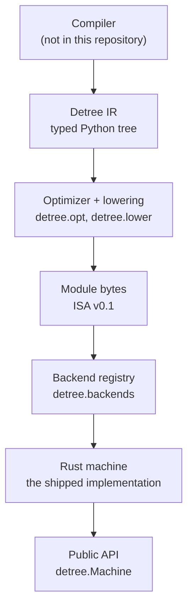

# Architecture

**Status: design note, not normative.** The normative contracts are in `spec/`.

## 1. The problem

Decoding a TTree basket is a tight, repetitive loop: read a big-endian scalar, skip an object header, follow a reference, append a value. TTree is flexible enough that every branch has its own shape, so the decoding logic has to stay data-driven and easy to extend, and it has to run close to native speed on formats with many small fields.

Three properties are in tension:

| Approach | Flexibility and extensibility | Shipping convenience | Performance |
|---|---|---|---|
| Pure Python | high | high | limited on complex layouts |
| C++ extension | medium | low: the extension is compiled against one upstream version to avoid ABI conflicts | high |
| DSL virtual machine | high: the decoding program is data | high: a module is data and needs no rebuild | close, with a small dispatch cost |

The Awkward Forth virtual machine solves the same problem and performs well, but Forth cannot express ROOT reference pointers, so it cannot cover every decoding path. A domain-specific language for TTree used to cost more to design and maintain than it returned; AI-assisted development changes that calculation.

The second problem is portability. The machine must be implementable in more than one language, comparable across implementations, and embeddable without a Python ABI. That rules out "pass a Python object to C++" and "call a C++ class from Rust".

## 2. Three layers



**Layer 1 — module bytes.** The compiler and every machine agree on the byte layout in `spec/module.md`. A module is self-contained: code, buffers, states, strings, layouts, and functions. Nothing else crosses this boundary.

**Layer 2 — C ABI.** The Rust machine exports the C99 interface (`spec/c-api.md`). The ABI is independent of Python: one build serves every interpreter, and a C or Rust program can load the same library.

**Layer 3 — Python backend protocol.** The public API talks to a `Machine` object with `run`, `state_values`, `reset`, and `close`. The Rust machine implements it through one `ctypes` binding.

The repository also carries two development-only builds: a Python reference machine, used as the conformance oracle, and a C++ build, used for performance comparison. Neither is a supported deployment path; the release artifact is built around the Rust machine.

## 3. Dependency rule

The package imports downward only:

```text
spec
├── ir ──► opt ──► lower
├── vm
└── abi ──► backends ──► detree/__init__.py
```

- `spec` imports nothing else from the package.
- `ir` imports `spec` only.
- `opt` imports `ir` and `spec`.
- `lower` imports `ir` and `spec`.
- `vm` is the development-only Python reference and imports `spec` only.
- `abi` and `backends` may import `spec`, `vm`, and NumPy.

No module imports an external framework or its array library. `tests/test_imports.py` enforces the boundary.

## 4. Why bytes, not objects

If a machine took a decoded `Module` object, every implementation would need a Python binding or a shared C++ class hierarchy. The byte format makes the contract explicit, testable, and portable:

- the compiler can be written in any language;
- a machine can be written in any language;
- the golden corpus is a set of byte strings, not a serialized object graph;
- a content hash identifies a module for caching and deduplication.

Every machine decodes bytes itself rather than reusing the compiler's objects; that independence is what makes the byte-level checks meaningful.

## 5. What is outside

The compiler owns everything that is not the VM:

- turning a schema or a source description into IR;
- naming buffers and states;
- giving meaning to the decoded values;
- reconstructing arrays from the output buffers.

Detree only knows TTree stream shapes: scalars, `fNBytes`, `TObject` headers, references, and typed buffers. It does not know what the decoded values mean.

## 6. Lifecycle

```text
compile → module bytes → machine_new → run(basket) × N → free
```

A machine is built once per module and reused for every basket. `run` resets the machine first, so no state survives between baskets. Output storage is allocated fresh on each reset; a finished basket's arrays remain valid for the caller.

One machine belongs to one thread. A caller that decodes baskets in parallel builds one machine per worker.

## 7. What can change independently

| Change | Requires |
|---|---|
| an optimizer pass | no module or ABI change; re-record the corpus |
| a new opcode | `ISA_MINOR` bump, the Rust machine, corpus |
| a new development build | the C ABI, the corpus, no compiler change |
| a new compiler | the IR contract only |
| a new buffer dtype | `ISA_MINOR` or major bump, the Rust machine |

The design deliberately keeps the compiler and the machines independently replaceable. That is the property the next sections rely on.
